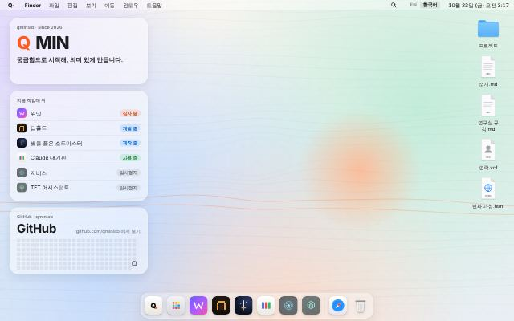
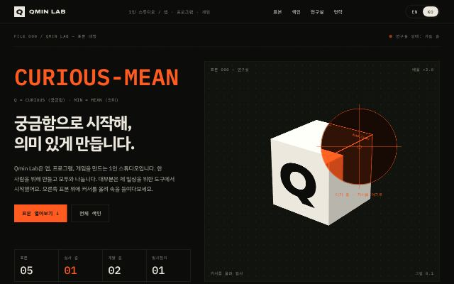
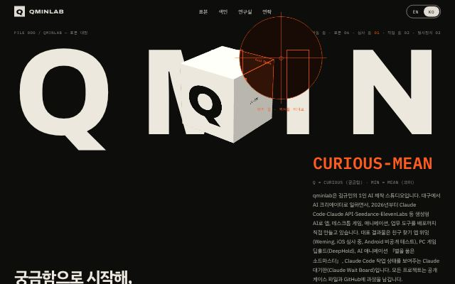

<div align="center">

# Q MIN

**Curious + Mean.** 궁금함으로 시작해, 의미 있게 만듭니다.

[qminlab.com](https://qminlab.com) 의 소스 코드입니다.



</div>

---

## 이게 뭔가요

qminlab은 김규민의 1인 AI 제작 스튜디오입니다. 앱, 게임, 애니메이션, 업무 도구까지 장르를 가리지 않고 AI와 함께 만들고, 만든 것은 이 사이트에 올립니다.

홈페이지 자체도 하나의 작품이라 생각하고 만들었어요. 지금 버전 **Qmin OS**는 사이트 전체가 하나의 운영체제처럼 움직입니다.

- **컴퓨터에서는 macOS 데스크톱.** 메뉴 막대, 끌어서 옮기는 위젯, 확대되는 Dock, 아이콘에서 튀어나오는 창, Spotlight(⌘/Ctrl + K), Launchpad(핀치), Mission Control(왼쪽 위 구석, F3), 데스크톱 보기, 훑어보기(Space), 오른쪽 클릭 메뉴까지.
- **휴대폰에서는 iOS 홈 화면.** 실제 아이폰에서 잰 크기의 유리 위젯과 Dock, 여러 페이지, 폴더, 아이콘에서 커지며 열리는 앱, 홈 바로 닫기, 길게 눌러 편집.
- **앱 하나가 작품 하나.** 위밍은 폰 안에서 진짜로 눌러볼 수 있고, 딥홀드는 도트 화면이 움직이고, 소드마스터는 한 컷이 만들어지는 과정을 보여줍니다.
- **배치는 방문자 마음대로.** 아이콘, 위젯, Dock 순서를 바꾸면 그 브라우저에 기억됩니다.
- **지난 홈페이지도 그대로.** `변화 과정.html`을 열면 예전 버전이 당시 모습 그대로 Safari 창에서 열립니다.

## 올라가 있는 작품

| | 이름 | 종류 | 상태 |
|---|---|---|---|
| QL-001 | **위밍** Weming | 앱 · iOS / Android | 심사 중 |
| QL-004 | **딥홀드** DeepHold | 2.5D 도트 액션 게임 · PC | 개발 중 |
| QL-006 | **별을 품은 소드마스터** The Stellar Swordmaster | AI 애니메이션 | 제작 중 |
| QL-005 | **Claude 대기판** Claude Wait Board | 아이패드 작업 현황판 | 사용 중 |
| QL-002 | **자비스** Jarvis | AI 비서 겸 감독관 | 일시정지 |
| QL-003 | **TFT 어시스턴트** | 게임 화면 오버레이 | 일시정지 |

작품 정보는 모두 `messages/ko.json`, `messages/en.json` 한 곳에서 나옵니다.

## 변화 과정

| 버전 | 시작 | 한 줄 |
|---|---|---|
| v1 · Specimen Lab | 2026-10-08 | 작품을 연구실 표본처럼 진열한 첫 홈페이지 |
| v2 · Open Lab | 2026-10-16 | 테두리를 걷어내고 큰 글자와 가로 스크롤로 다시 짠 버전 |
| v3 · Qmin OS | 2026-10-23 | 사이트 전체를 macOS / iOS처럼 만든 지금 버전 |

<p>



</p>

예전 버전은 `scripts/build-archive.sh <커밋> <날짜>`로 git 기록에서 다시 빌드해 `public/archive/<날짜>/`에 넣어 둡니다. 지우지 않고 계속 쌓아요.

## 만든 재료

- **Next.js** (App Router, 정적 내보내기) · **TypeScript**
- **GSAP** · **Lenis** 로 움직임과 스크롤
- three.js 없이 직접 쓴 작은 **WebGL** 렌더러 (`src/components/three/gl.ts`)
- **Paper Shaders**의 리퀴드 메탈
- **next-intl** 로 한국어 / 영어 (언어는 나중에 더 늘릴 수 있게)
- **Cloudflare Pages** + Pages Functions
- 그리고 처음부터 끝까지 **Claude Code**

## 직접 돌려보기

```bash
npm ci
npm run dev        # http://localhost:3000
npm run build      # 정적 사이트를 out/ 에 만들어요
npm run typecheck
```

## 구조

```
src/app/[locale]/       페이지 (홈, about, faq, work/<코드>, deephold)
src/components/os/      Qmin OS: 데스크톱, 홈 화면, 창, Dock, 앱
src/components/objects/ 작품별 3D 오브젝트
messages/               한국어 · 영어 문구와 작품 정보
functions/              Cloudflare Pages Functions
public/archive/         지난 홈페이지 빌드
scripts/                예전 버전 다시 빌드하기 등
```

`functions/` 에서 하는 일:

- `index.js` 는 `/` 로 들어온 방문자를 언어에 맞게 `/ko/` 또는 `/en/` 으로 보냅니다. 헤더에서 고른 언어, 브라우저 언어, 접속 국가 순서로 봐요.
- `api/github.js` 는 데스크톱 GitHub 위젯에 [github.com/qminlab](https://github.com/qminlab) 의 기여 기록을 한 시간 단위로 캐시해서 전해 줍니다.
- `notes/` 는 이 저장소에 없는 비공개 페이지로 요청을 넘겨 줍니다.

## 배포

`main`에 올라가면 Cloudflare Pages가 자동으로 배포합니다.

- 프레임워크: Next.js (Static HTML Export)
- 빌드 명령: `npx next build`
- 출력 폴더: `out`

## 권리

코드는 읽고 배우라고 열어 두었습니다. 이미지, 글, 게임 스프라이트, 영상 등 콘텐츠의 저작권은 qminlab에 있습니다(All rights reserved). `public/deephold/fonts/` 의 Galmuri 글꼴은 SIL Open Font License를 따릅니다(`OFL.md`).

---

<div align="center">

[qminlab.com](https://qminlab.com) · [hello@qminlab.com](mailto:hello@qminlab.com) · [github.com/qminlab](https://github.com/qminlab)

since 2026

</div>
